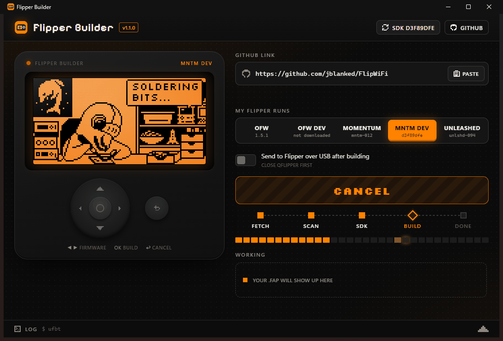
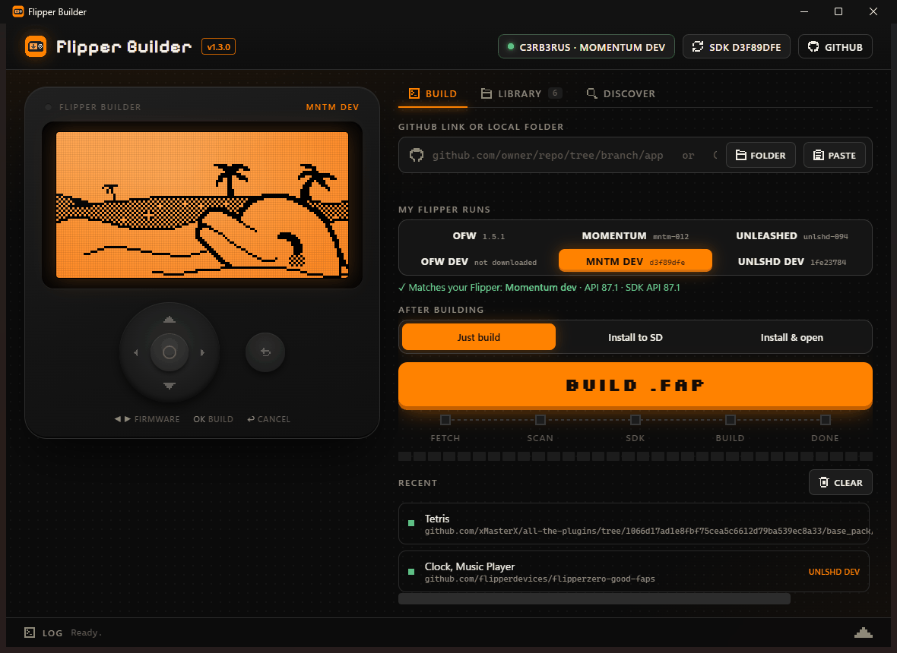

# Flipper Builder

Paste a GitHub link to a Flipper Zero app, press **Build**, get a `.fap`.



A Windows app around [ufbt](https://github.com/flipperdevices/flipperzero-ufbt), Flipper's official
micro build tool. No command line, no SDK setup: it fetches the right SDK for your firmware, clones the
repo, finds the app(s), builds them and hands you the `.fap`. The dolphin keeps you company on a
Flipper-style LCD the whole time: it reads the repo, solders while it compiles, DJs when it's done
and cries when the build breaks.

## Features

- **Any GitHub link**: a repo, a branch, a subfolder (`/tree/dev/some_app`), a file (`/blob/...`)
  or a commit. Branch names with slashes are resolved correctly. Drag and drop a link onto the
  window, or copy one before opening the app and it's pasted in for you.
- **Every big firmware**: Official, Momentum and Unleashed, each as release or dev build.
  Pick the one your Flipper runs, or the app will show "API mismatch".
- **Live progress**: fetch, scan, SDK, build stages, a compile progress bar, and the full log in a
  slide-up drawer.
- **Knows your Flipper**: plug it in over USB and the app reads its firmware (Official, Momentum or
  Unleashed, release or dev) and API version, picks the matching SDK, and warns you before building
  something that won't run on it.
- **Install straight to the Flipper**: after building, *Install to SD* copies the `.fap` into
  `apps/<Category>/` over USB, or *Install & open* also launches it. Close qFlipper first.
- **See what's on your Flipper**: the *On Flipper* tab lists every app on the SD card with its real
  name, version and icon (read from each `.fap`'s own manifest), SD card space, and which apps won't
  open on your firmware. Open any app on the Flipper, remove it, or update it with a newer build from
  your Library. App info is cached, so only the first look reads the files.
- **Library + Rebuild all**: every app you build is remembered, with badges for what runs on your
  Flipper and what's outdated. After a firmware update, one click rebuilds them all for the new
  firmware (and installs them, if you like).
- **Discover**: search the 500+ apps in Flipper's official Apps Catalog and build any of them in one
  click, from the exact version Flipper reviewed.
- **Pick the apps you want**: repos with several apps open a checklist with each app's icon.
- **Errors in plain English**: a failed build tells you why (a function your firmware doesn't have,
  a missing library, an outdated app) and offers one-click "try another firmware" buttons.
- **Local folders + watch mode**: build an app from a folder on your PC, and let it rebuild (and
  reinstall) automatically every time you save. Handy when you write your own apps.
- **Results you can use**: each built app shows its own icon, size, and the SD card folder it belongs
  in, with buttons to open the folder, copy the SD path, install or open it on the Flipper.
- **Recent builds**, and a header notice when a new version of Flipper Builder is out.
- **Play with it like a Flipper**: the d-pad works. Left/right switches firmware, OK builds, Back
  cancels, up/down opens the log. Keyboard: arrows, Enter, Esc, Ctrl+L (link), Ctrl+F (search).
  Poke the dolphin.
- SDK refreshes itself once a day; **SDK** button in the header forces it (right after a firmware update).




## Install

Download `FlipperBuilder-win64.zip` from [Releases](../../releases), unzip anywhere, run
`FlipperBuilder.exe`. Needs Windows 10/11 with Microsoft Edge WebView2 (built into Windows 11).
The first build downloads Flipper's toolchain (a few hundred MB, once). SDKs and built apps are kept
next to the exe.

## Run from source

Needs Windows and Python 3.10+. Double-click `Flipper Builder.bat`, or:

```
python -m venv .venv
.venv\Scripts\pip install ufbt pywebview pyserial
.venv\Scripts\python flipper_builder.py                                                 # GUI
.venv\Scripts\python flipper_builder.py <github-url-or-folder> --fw momentum-dev [--send]  # CLI
```

`--fw` is one of `official`, `official-dev`, `momentum`, `momentum-dev`, `unleashed`, `unleashed-dev`.

The UI is plain HTML/CSS/JS in `ui/`. Open `ui/index.html` through any local web server and it runs
against a built-in mock, which is handy for working on the design.

## Build the exe

```
.venv\Scripts\pip install pyinstaller pillow
powershell -ExecutionPolicy Bypass -File tools\build_exe.ps1     # -> dist\FlipperBuilder\
powershell -ExecutionPolicy Bypass -File tools\install.ps1       # optional: Start menu, desktop, Apps list
```

`install.ps1` installs to `%LOCALAPPDATA%\Programs\FlipperBuilder` by default (`-Target <folder>` to
change it) and registers a per-user uninstaller. No admin rights needed.

## How it works

The window is a WebView2 page (pywebview) talking to the Python build engine. The exe bundles
ufbt's SDK downloader; compiling runs inside Flipper's own toolchain (`fbtenv.cmd` + SCons, exactly
what the `ufbt` command does), which ships its own Python, so the exe doesn't need Python installed.
USB talks to the Flipper with the SDK's own storage client (`scripts/flipper/storage.py`, the code
fbt uses); a copy ships as `flipper_storage.py` for before any SDK is downloaded. Discover indexes
[flipper-application-catalog](https://github.com/flipperdevices/flipper-application-catalog) and
caches it for a week.

## Credits

- **Dolphin animations**: from the [Flipper Zero firmware](https://github.com/flipperdevices/flipperzero-firmware)
  (`assets/dolphin/external`), © Flipper Devices Inc., GPL-3.0. `tools/fetch_assets.py` downloads
  and packs them into `ui/vendor/`.
- **Fonts**: [Silkscreen](https://fonts.google.com/specimen/Silkscreen) and
  [Pixelify Sans](https://fonts.google.com/specimen/Pixelify+Sans), SIL Open Font License 1.1
  (license texts in `ui/vendor/fonts/`).
- **ufbt** and the **storage client** (`flipper_storage.py`) by Flipper Devices, GPL-3.0.
- **App catalog index**: Flipper's official Apps Catalog; each app belongs to its author.

Flipper Builder is an unofficial community tool and is not affiliated with or endorsed by Flipper Devices Inc.
"Flipper Zero" is a trademark of Flipper Devices Inc.

## License

GPL-3.0, same as ufbt and the firmware artwork it bundles.
