# Flipper Workbench

[](../../releases/latest)
[](../../releases/latest)
[](LICENSE)

**Build, install and manage your Flipper Zero's apps from your PC.**

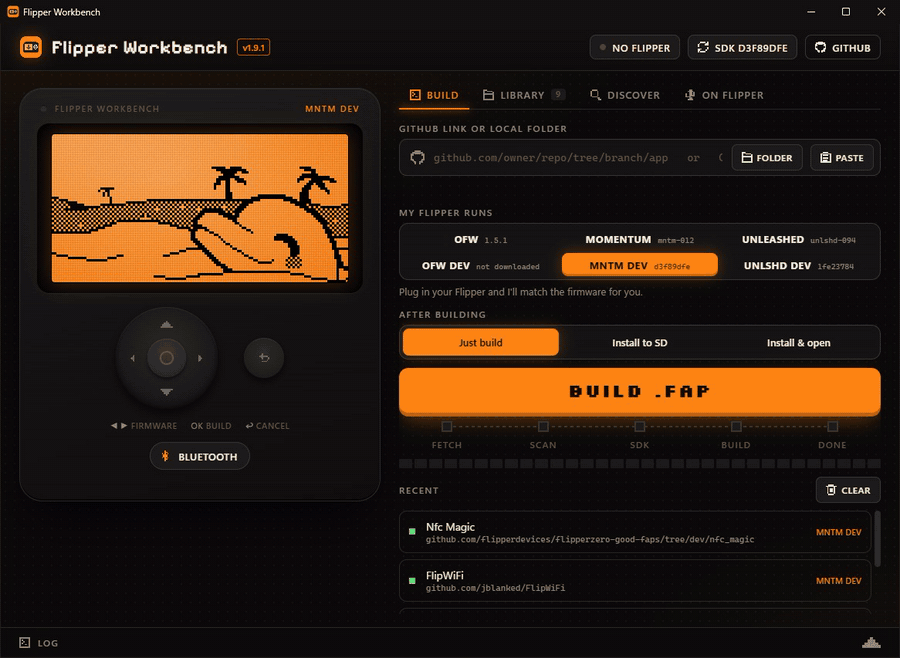

A Windows desktop companion for the Flipper Zero. Paste a GitHub link and it builds the app for your
exact firmware with [ufbt](https://github.com/flipperdevices/flipperzero-ufbt), Flipper's official
build tool, then installs it over USB. No command line, no SDK setup. It also lists and manages
every app on your Flipper, browses and backs up the SD card, and mirrors the Flipper's screen with a
working remote. The dolphin keeps you company on a Flipper-style LCD the whole time: it reads the
repo, solders while it compiles, DJs when it's done and cries when the build breaks.

*Called Flipper Builder up to version 1.5.0.*

**[Download the latest release](../../releases/latest)** · [User guide](docs/GUIDE.md) · [What's new](CHANGELOG.md)

## Quick start

1. Download `FlipperWorkbench-win64.zip`, unzip it anywhere, and run `FlipperWorkbench.exe`.
2. Plug in your Flipper (close qFlipper). The app reads its firmware and picks the matching SDK.
3. Paste a GitHub link to an app, or pick one on the **Discover** tab, and press **Build**.

## Features

The [user guide](docs/GUIDE.md) explains every feature step by step, with screenshots.

### Build

- **Any GitHub link**: a repo, a branch, a subfolder (`/tree/dev/some_app`), a file or a commit.
  Drag a link onto the window, or copy one before opening the app and it's pasted in for you.
- **Every big firmware**: Official, Momentum and Unleashed, each as a release or dev build.
- **Pick the apps you want**: repos with several apps open a checklist with each app's icon.
- **Live progress**: the dolphin, build stages, a compile progress bar, and the full log in a slide-up drawer.
- **Errors in plain English**: a failed build says why (a function your firmware doesn't have, a
  missing library, an outdated app) and offers one-click "try another firmware" buttons.
- **Local folders + watch mode**: build from a folder on your PC and rebuild (and reinstall)
  automatically on every save. Handy when you write your own apps.

### Your Flipper

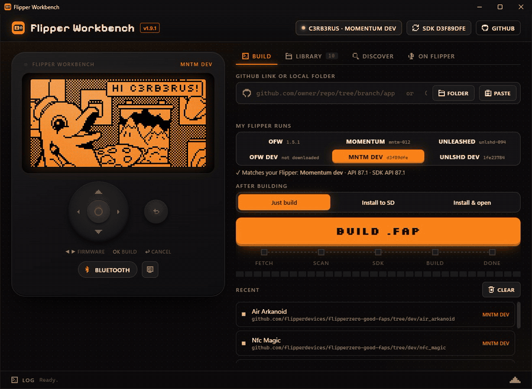

- **Knows your Flipper**: plug it in and the app reads its firmware and API version, selects the
  matching SDK, and warns you before building something that won't run on it.
- **Install straight to it**: *Install to SD* copies the `.fap` into `apps/<Category>/`, or
  *Install & open* also launches it.
- **Firmware updates**: update to the latest Official, Momentum or Unleashed (release or dev) in
  two steps. *Prepare* backs up your SD card, downloads the official package, checks its SHA-256,
  copies it to the Flipper and checks every file there; nothing is installed until you confirm
  again. Then the Flipper's own updater takes over, exactly as with qFlipper. Battery and free space
  are checked first, and afterwards one click rebuilds your apps for the new firmware.
- **See what's on it**: the *On Flipper* tab lists every app on the SD card with its real name,
  version and icon, plus SD card space and which apps won't open on your firmware. Open, remove or
  update any of them, from your Library or straight from Flipper's catalog when it has a newer version.
- **Clean up**: finds the same app in two folders, apps that won't open on your firmware, old
  firmware update packages and leftover temp files. You tick what goes; nothing is deleted on its own.
- **SD card map**: a map of what fills the SD card, folder by folder (click to look inside, or open it
  in Files), plus space by file type.
- **Screen mirror + remote**: plug in your Flipper and the app's LCD shows its real screen, live (a
  small screen icon pauses it). The d-pad and
  your keyboard (arrows, Enter, Backspace) press the real buttons, holding one does a long press,
  and one click saves a screenshot. Click the screen to go full screen, like qFlipper (Esc, F11 or
  another click to leave), and record it as a GIF (up to 60 s) to share. Screenshots and GIFs can
  come inside a drawn Flipper (the frame button).
- **More than one Flipper**: with several plugged in, click the Flipper button in the header to pick one.
- **CLI**: your Flipper's own command line in a terminal tab. Type any command (`help`, `neofetch`,
  `storage info /ext`, `log`...) and the output streams back; Up/Down recall earlier commands, Stop
  or Ctrl+C ends commands that keep running. Commands that delete things, change settings or
  transmit ask first.
- **Files**: browse the whole SD card; upload, download, rename, make folders and delete.
- **Capture viewer**: click a `.sub`, `.ir`, `.nfc`, `.rfid` or `.ibtn` file to see it in plain
  language: Sub-GHz frequency, modulation and the signal itself, every button of an IR remote (with
  *Send* to fire one from the Flipper), an NFC card's type, UID and blocks. Two NFC dumps can be
  compared byte by byte.
- **IR remote editing**: rename, reorder and remove the buttons of a remote, or add all the buttons of
  another remote to it.
- **Script editor**: write and edit BadUSB scripts and JavaScript apps with syntax highlighting,
  save them straight to the SD card (Ctrl+S), and *Save & run* a JS app with its output in the CLI.
- **Backups**: one click backs up your captures, NFC/RFID dumps, IR remotes, BadUSB scripts and app
  data to a zip on your PC, and puts them back later. With auto backup on (the default), plugging in
  your Flipper backs it up once a day; the last 5 automatic backups are kept, yours never deleted.

### Library & Discover

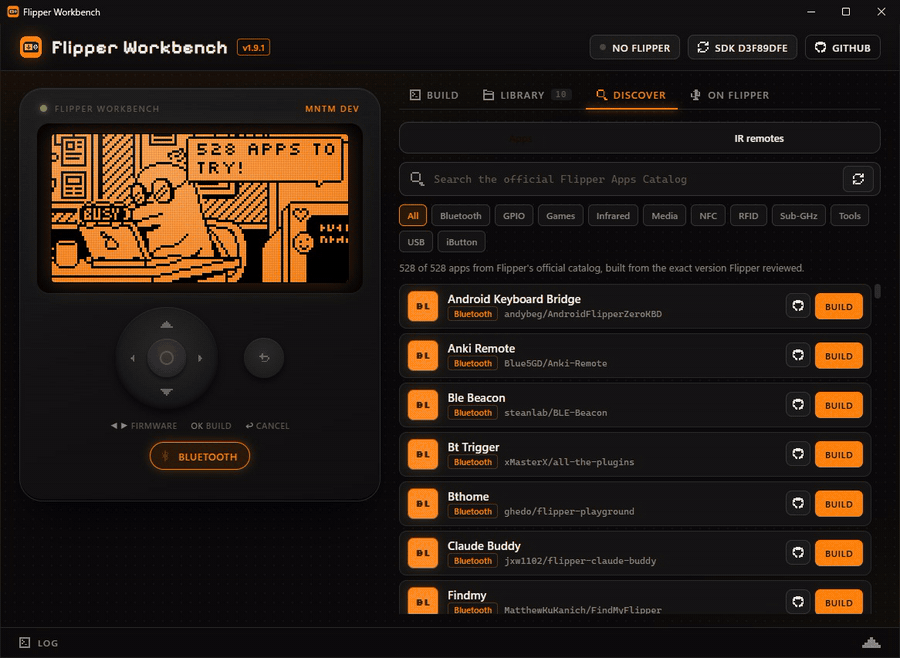

- **Library + Rebuild all**: every app you build is remembered, with badges for what runs on your
  Flipper and what's outdated. After a firmware update, one click rebuilds them all (and installs them).
- **Discover**: search the 500+ apps in Flipper's official Apps Catalog and build any of them in
  one click, from the exact version Flipper reviewed.
- **IR remote library**: search the 8,900 remotes of the community
  [Flipper-IRDB](https://github.com/Lucaslhm/Flipper-IRDB) by brand, model or device, try their
  buttons from your Flipper before you keep one, and install it to `infrared/` in one click.

### Tools

- **Music**: turn a MIDI file or an RTTTL ringtone into a song for the Flipper's Music Player. Hear it
  in the app first (square wave, like the Flipper's buzzer), then save it to the SD card.
- **Health check**: free memory with a live graph and the lowest point since the last restart, battery
  and SD card, plus how much memory each asset pack needs, with one click to shrink old uncompressed
  animations. Handy when your Flipper says it's out of memory.
- **IR remote builder**: one remote from buttons of any remote (IR database, your Flipper, learned from a
  real remote or typed in), each tested before you save it.
- **BadUSB scripts**: edit scripts with highlighting and a checker, and pick the keyboard layout.
- **Passport** (Momentum): change your Flipper's name. **Profiles**: save a whole setup and switch between
  setups.
- **Studio**: one editor for your Flipper's look, next to its live screen. Turn a **video, GIF or picture**
  into a desktop animation: trim it, set the frame rate (up to 30 fps), max frames, threshold, contrast,
  dither, fit, zoom and framing, invert and background. Then edit it frame by frame: draw and erase pixels,
  duplicate, reorder or remove frames, with undo. Play it live on your real Flipper before installing, and
  send it to an asset pack or the dolphin folder.
- **NFC maker**: make an NFC tag from scratch. Pick what a phone should do when it taps your Flipper
  (open a link, join Wi-Fi, save a contact, call, text, email, show a place on the map, open an
  Android app, pair Bluetooth, or show some text), fill in the blanks and Workbench writes a ready
  NTAG213/215/216 `.nfc` file. Several records fit on one tag; a meter shows how full it is. Save it
  to the Flipper, save and start emulating in one click, or keep it on your PC.
- **Asset packs** (Momentum): browse and install the animation and icon packs from Momentum's pack
  library, checksum-verified.
- **Pack maker** (Momentum): build your own asset pack from GIFs and pictures: desktop animations,
  passport art, any of Flipper's icons and fonts, each previewed in black and white. Or import one
  from a zip or folder (ready-made packs, PNG source packs and dolphin folders all work): every file
  is checked and anything broken is left out. A memory bar shows how heavy the pack is, built-in tips
  explain the rest, and it installs in one click or saves as a zip to share.
- **Folder sync**: pair a PC folder (say, your BadUSB scripts in a Git repo) with an SD card folder and
  keep them in step one way or both ways. Files are compared by size and MD5, you see every change
  before it happens, conflicts are yours to settle, and deleting extras is opt-in (PC files go to a
  `.workbench-trash` folder, never straight away).
- **Companion app**: builds and installs *Workbench* to your Flipper's Apps > Tools: open it there to
  see when Workbench last connected, backed up and synced.
- **New app**: start your own Flipper app from a template (hello screen, menu app, LED blinker or a
  JavaScript app). One click builds it, installs it and rebuilds on every save; *CLI > Follow log*
  shows just your app's log lines while you test (it pauses for a moment whenever Workbench uses USB
  for something else, like installing a rebuild).
- **MIFARE keys**: manage your own MIFARE Classic keys (`mf_classic_dict_user.nfc`), which the
  Flipper tries on top of its built-in list.
- **Wi-Fi dev board**: flash the official Black Magic debugger firmware onto the ESP32-S2 Wi-Fi board,
  or drop in any compatible firmware file (.bin, or a .zip/.tgz package). Every part is checked to be
  an ESP32-S2 image before anything is written.
- **Phone remote**: your Flipper's screen and buttons on your phone over home Wi-Fi: scan the code,
  no app needed. Off until you switch it on, home network only, secret link, stops when Workbench closes.
- **Bluetooth**: mirror and control your Flipper without a cable. Click the **Bluetooth** button under
  the screen; the first time, type the PIN your Flipper shows (right in Workbench). After that it
  reconnects in a couple of seconds.

### Little things

- The d-pad works like a Flipper's: left/right switches firmware, OK builds, Back cancels. Keyboard:
  arrows, Enter, Esc, Ctrl+L (link), Ctrl+F (search). Poke the dolphin.
- SDKs refresh themselves once a day; the **SDK** button in the header forces it.
- Updates itself: when a new version is out, one click downloads it, checks it against GitHub's
  SHA-256 and restarts into it. Your SDKs, built apps, library, settings and backups stay, and if the
  swap fails the old version is put back.

## Screenshots

| | |
|---|---|
| 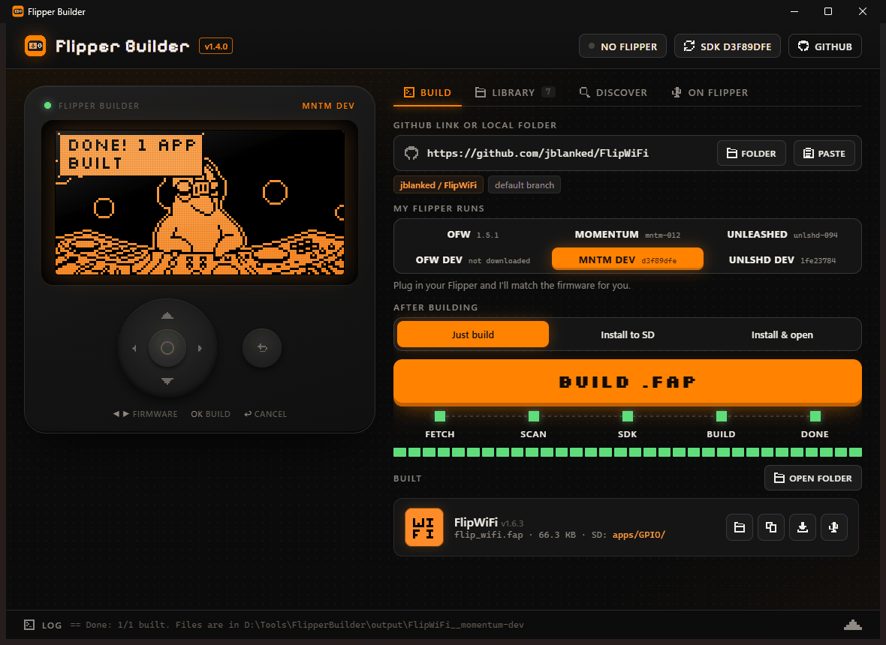 | 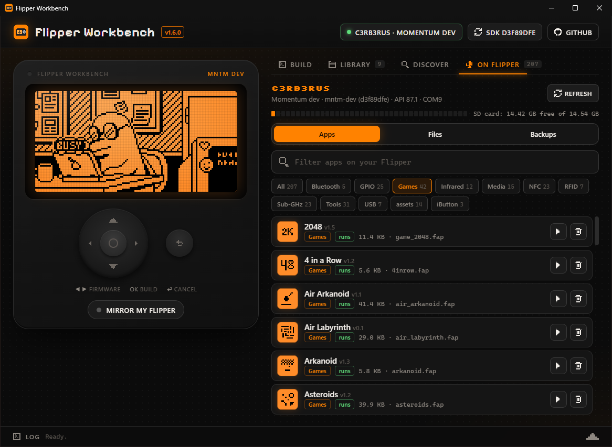 |
| **Done**: the dolphin DJs, and the app's card shows where it goes on the SD card | **On Flipper**: everything on the SD card, with real names, icons and versions |
| 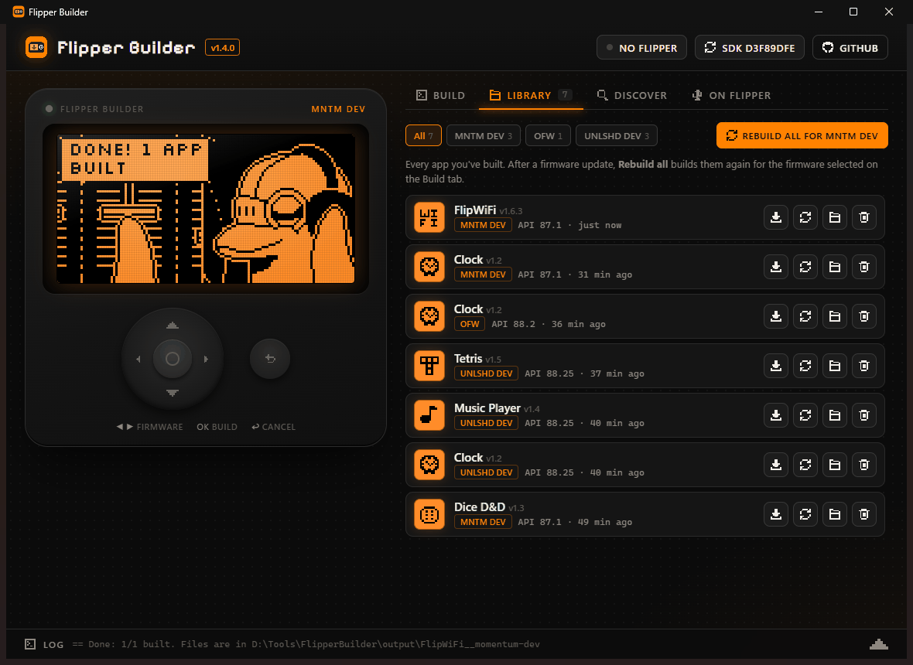 | 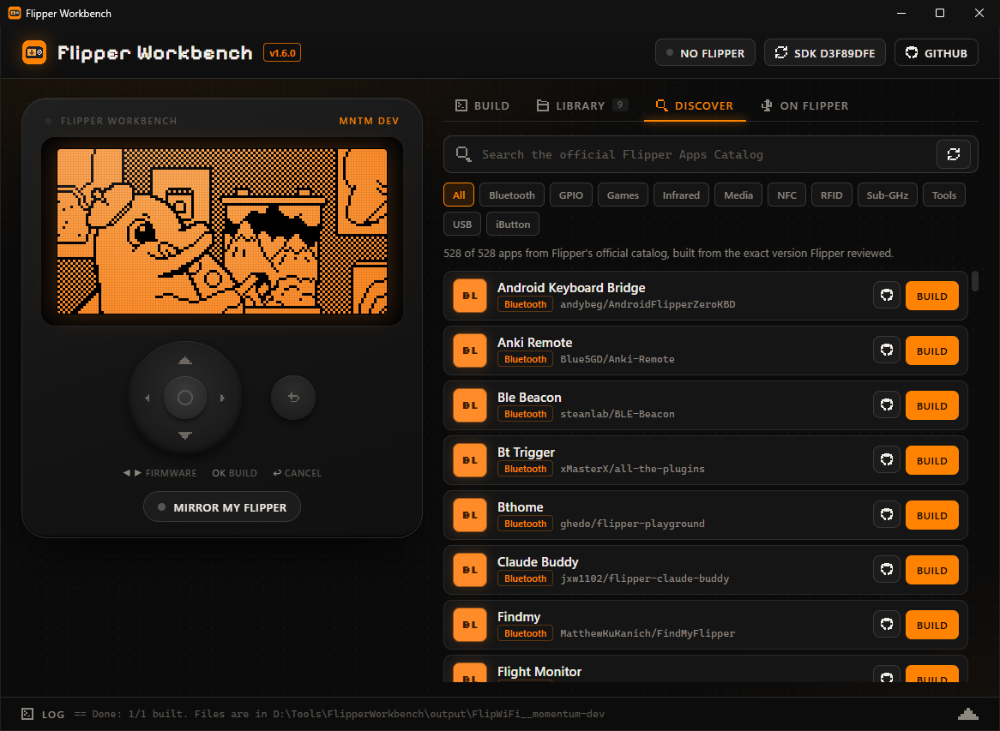 |
| **Library**: every build, per firmware, with Rebuild all | **Discover**: 500+ apps from Flipper's official catalog |
| 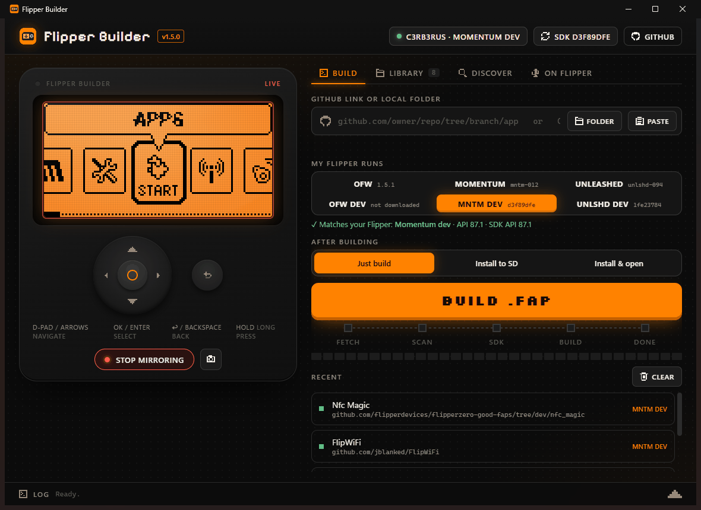 | 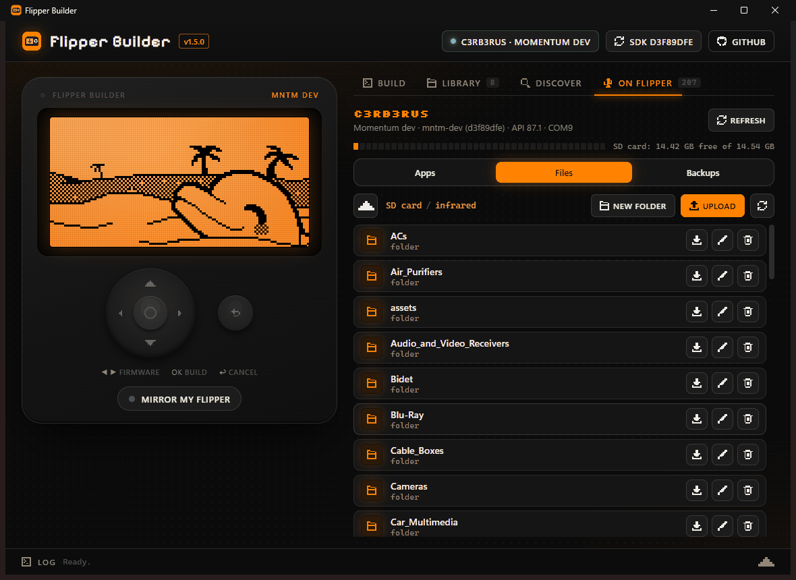 |
| **Mirror**: your Flipper's real screen, controlled from the app | **Files**: the whole SD card, with upload, download and backups |

| | |
|---|---|
| 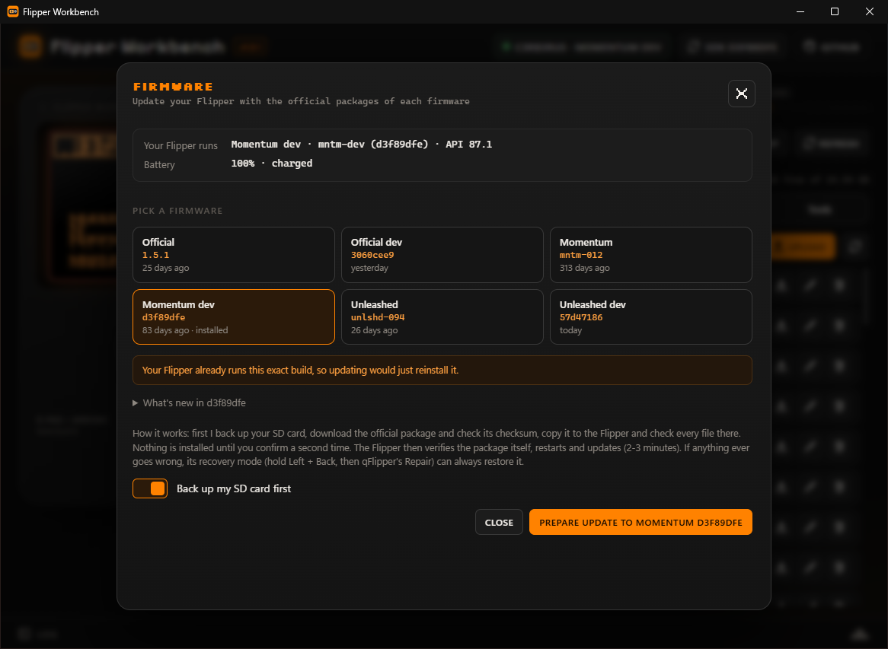 | 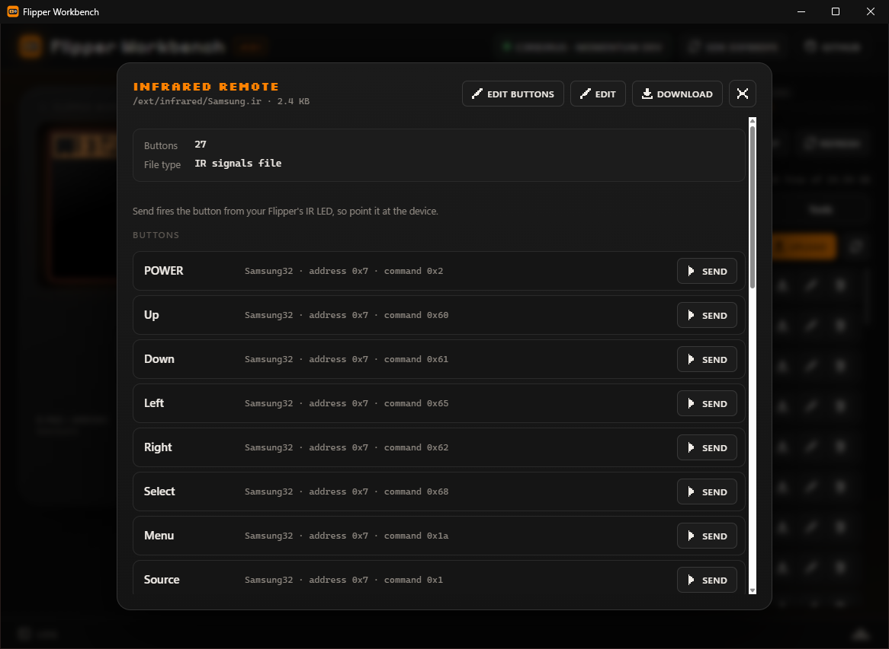 |
| **Firmware**: official packages of every firmware, checked twice before anything is installed | **Capture viewer**: an IR remote's buttons, each one ready to send |
| 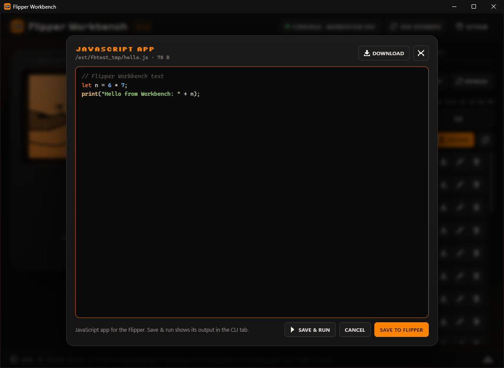 | 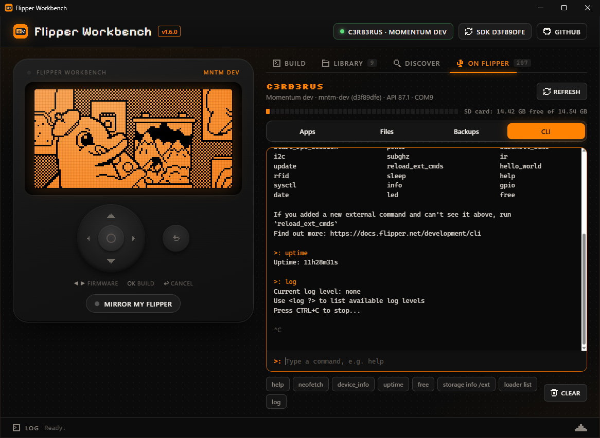 |
| **Script editor**: BadUSB and JavaScript, saved straight to the SD card | **CLI**: the Flipper's own command line, with history and a Stop button |
| 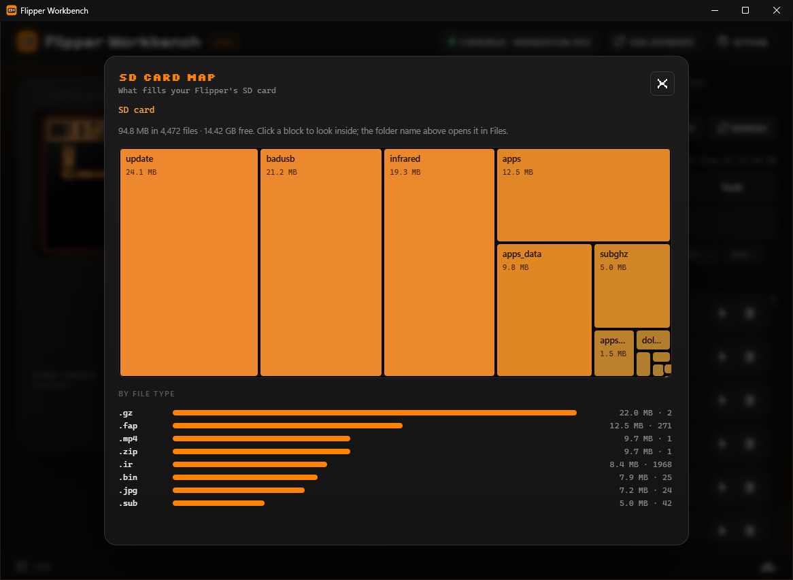 | 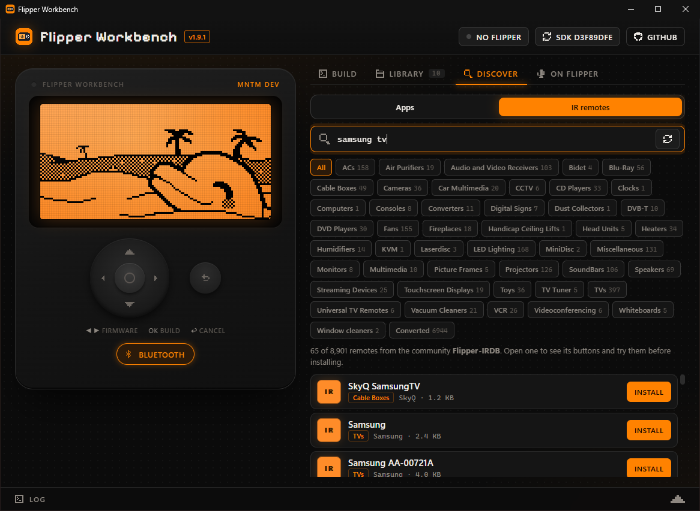 |
| **SD map**: what fills the SD card, block by block | **IR remotes**: 8,900 community remotes, searchable, tried before you install |

## Install

With [Scoop](https://scoop.sh):

```
scoop install https://raw.githubusercontent.com/c3rb3ruszx/flipper-workbench/main/packaging/scoop/flipper-workbench.json
```

Or download `FlipperWorkbench-win64.zip` from [Releases](../../releases/latest), unzip anywhere and run
`FlipperWorkbench.exe`. Needs Windows 10 or 11 with Microsoft Edge WebView2 (built into Windows 11).
The first build downloads Flipper's toolchain (a few hundred MB, once). SDKs and built apps are kept
next to the exe. For USB features, close qFlipper: only one program can use the Flipper's USB port.

## Run from source

Needs Windows and Python 3.10+. Double-click `Flipper Workbench.bat`, or:

```
python -m venv .venv
.venv\Scripts\pip install ufbt pywebview pyserial pillow heatshrink2 imageio-ffmpeg
.venv\Scripts\python flipper_workbench.py                                                    # GUI
.venv\Scripts\python flipper_workbench.py <github-url-or-folder> --fw momentum-dev [--send]  # CLI
```

`--fw` is one of `official`, `official-dev`, `momentum`, `momentum-dev`, `unleashed`, `unleashed-dev`.

The UI is plain HTML/CSS/JS in `ui/`. Open `ui/index.html` through any local web server and it runs
against a built-in mock, which is handy for working on the design.

## Build the exe

```
.venv\Scripts\pip install pyinstaller pillow
powershell -ExecutionPolicy Bypass -File tools\build_exe.ps1     # -> dist\FlipperWorkbench\
powershell -ExecutionPolicy Bypass -File tools\install.ps1       # optional: Start menu, desktop, Apps list
```

`install.ps1` installs to `%LOCALAPPDATA%\Programs\FlipperWorkbench` by default (`-Target <folder>` to
change it) and registers a per-user uninstaller. No admin rights needed. It also takes over an old
Flipper Builder install: SDKs, built apps, library and settings move to the new folder, and the old
shortcuts and Apps entry are removed.

## macOS (experimental, untested)

The code is ready for macOS (builds use the toolchain's `fbtenv.sh`, like `ufbt` does there; data
lives in `~/Library/Application Support/Flipper Workbench`), but no Mac build has been tried yet.
To build one on a Mac:

```
python3 -m venv .venv
.venv/bin/pip install ufbt pywebview pyserial pyinstaller pillow heatshrink2 imageio-ffmpeg
bash tools/build_mac.sh            # -> dist/Flipper Workbench.app
```

The app isn't signed, so open it the first time with right-click > Open. Reports welcome.

## How it works

The window is a WebView2 page (pywebview) talking to the Python build engine. The exe bundles
ufbt's SDK downloader; compiling runs inside Flipper's own toolchain (`fbtenv.cmd` + SCons, exactly
what the `ufbt` command does), which ships its own Python, so the exe doesn't need Python installed.
The screen mirror switches the port to Flipper's protobuf RPC (the protocol qFlipper uses) and
streams screen frames and button events; other USB jobs pause it and hand the port back. The CLI
tab sends each command to the Flipper's serial console and streams the reply until the prompt comes
back (Stop sends Ctrl+C). USB uses
the SDK's own storage client (`scripts/flipper/storage.py`, the code fbt uses); a copy ships
as `flipper_storage.py` for before any SDK is downloaded. App names, versions and icons come from
each `.fap`'s `.fapmeta` manifest (`fapmeta.py`). Discover indexes
[flipper-application-catalog](https://github.com/flipperdevices/flipper-application-catalog) and
caches it for a week.

## Credits

- **Dolphin animations**: from the [Flipper Zero firmware](https://github.com/flipperdevices/flipperzero-firmware)
  (`assets/dolphin/external`), © Flipper Devices Inc., GPL-3.0. `tools/fetch_assets.py` downloads
  and packs them into `ui/vendor/`.
- **Fonts**: [Silkscreen](https://fonts.google.com/specimen/Silkscreen) and
  [Pixelify Sans](https://fonts.google.com/specimen/Pixelify+Sans), SIL Open Font License 1.1
  (license texts in `ui/vendor/fonts/`).
- **ufbt** and the **storage client** (`flipper_storage.py`) by Flipper Devices, GPL-3.0.
- **App catalog index**: Flipper's official Apps Catalog; each app belongs to its author.
- **Video conversion**: [FFmpeg](https://ffmpeg.org), GPL, shipped through
  [imageio-ffmpeg](https://github.com/imageio/imageio-ffmpeg).

Flipper Workbench is an unofficial community tool and is not affiliated with or endorsed by Flipper Devices Inc.
"Flipper Zero" is a trademark of Flipper Devices Inc.

## License

GPL-3.0, same as ufbt and the firmware artwork it bundles.
