# Flipper Workbench user guide

Everything Flipper Workbench does, why it's there, and how to use it, with pictures.

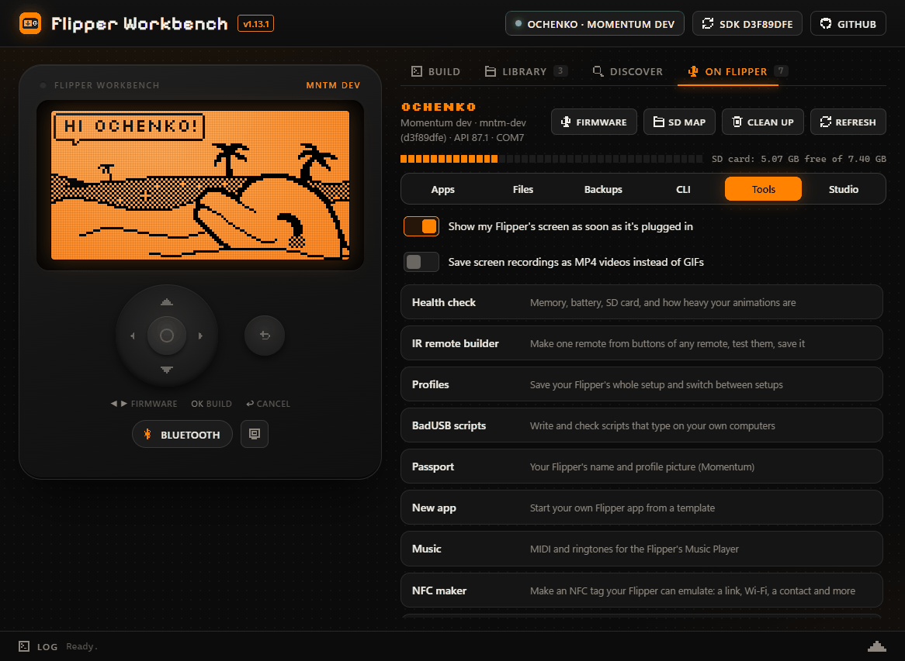

**Contents**

1. [What Flipper Workbench is](#1-what-flipper-workbench-is)
2. [Getting started](#2-getting-started)
3. [A tour of the window](#3-a-tour-of-the-window)
4. [Build and install apps](#4-build-and-install-apps)
5. [Library and Discover](#5-library-and-discover)
6. [Your Flipper: the On Flipper tab](#6-your-flipper-the-on-flipper-tab)
7. [Screen mirror and remote control](#7-screen-mirror-and-remote-control)
8. [Tools](#8-tools)
9. [Studio: animations and asset packs](#9-studio-animations-and-asset-packs)
10. [Updates, settings and where your files live](#10-updates-settings-and-where-your-files-live)
11. [Troubleshooting](#11-troubleshooting)
12. [Using it responsibly](#12-using-it-responsibly)

---

## 1. What Flipper Workbench is

Flipper Workbench is a free Windows app for the [Flipper Zero](https://flipperzero.one). It puts everything
you'd normally do with your Flipper on a PC into one window: getting apps onto it, looking after what's on
it, and making things for it.

### The problem it solves

Most Flipper apps live on GitHub as source code. A Flipper only runs an app that was built for the exact
firmware it has (an app built for another firmware shows **API mismatch**), and building one normally means
installing Flipper's SDK, using a command line and knowing which firmware version to target. Flipper
Workbench does all of that for you: paste a link, press **Build**, and the app is compiled for your
Flipper's firmware and copied onto it.

Around that core it grew into a complete companion:

| You want to... | Workbench gives you |
|---|---|
| Install apps from GitHub or Flipper's catalog | One-click builds for your exact firmware, installed over USB |
| Keep apps working after a firmware update | A Library of everything you built, with **Rebuild all** |
| See and manage what's on the Flipper | Apps list with real names and icons, file browser, SD card map, clean up, backups |
| Update the firmware | Official, Momentum or Unleashed packages, checked before anything is installed |
| Use the Flipper from your desk | A live mirror of its screen, keyboard and mouse control, screenshots and recordings |
| Make things for it | IR remotes, BadUSB scripts, NFC tags, music, desktop animations, whole asset packs, your own apps |
| Understand what it's doing | Health check, the Flipper's own command line, a capture viewer for `.sub`, `.ir`, `.nfc` files and more |

### Who it's for

- **New Flipper owners** who want apps from the community without learning the build tools.
- **Regular users** who want backups, firmware updates and their files in one place.
- **Tinkerers and developers** who write scripts, make animations and asset packs, or build their own apps
  and want them rebuilt and reinstalled every time they save.

It works with the **Official**, **Momentum** and **Unleashed** firmware, each as a release or dev build. A
few features (Passport, Pack maker, Asset packs, Profiles) use Momentum's extra options and say so.

---

## 2. Getting started

### What you need

- Windows 10 or 11 (64-bit) with Microsoft Edge WebView2, which is built into Windows 11 and installed on
  most Windows 10 PCs.
- A Flipper Zero and a USB cable that carries data (some cheap cables only charge).
- An internet connection for building apps, the catalog and firmware updates. The first build downloads
  Flipper's build toolchain, a few hundred MB, once.

### Install

**Option 1, the zip:** download `FlipperWorkbench-win64.zip` from the
[latest release](https://github.com/c3rb3ruszx/flipper-workbench/releases/latest), unzip it anywhere you like, and run `FlipperWorkbench.exe`.

**Option 2, [Scoop](https://scoop.sh):**

```
scoop install https://raw.githubusercontent.com/c3rb3ruszx/flipper-workbench/main/packaging/scoop/flipper-workbench.json
```

### First run

1. **Close qFlipper** (and any web page connected to your Flipper). Only one program can use the Flipper's
   USB port at a time.
2. **Plug in your Flipper.** Within a few seconds the header shows its name and firmware, the left screen
   shows the Flipper's real display, and Workbench picks the matching build kit (SDK) for its firmware.
3. **Try a build:** open **Discover**, pick any app, press **Build**, then **Install to SD**.

> **Tip:** with auto backup on (the default), Workbench backs up your Flipper's captures and settings once a
> day when you plug it in. See [Backups](#backups).

---

## 3. A tour of the window

The window has two halves.

**Left: the Flipper.** A Flipper-style screen and d-pad. When your Flipper is plugged in it shows the
Flipper's real screen, live, and the buttons press the real buttons. With no Flipper it shows the dolphin,
who reacts to what Workbench is doing: reading a repo, soldering while it compiles, celebrating when a
build works and crying when one fails. Under the d-pad are buttons for the mirror, screenshots, the
screenshot frame and recording.

**Right: the tabs.**

| Tab | What's in it |
|---|---|
| **Build** | Paste a GitHub link or pick a folder, choose the firmware, build |
| **Library** | Every app you've built, per firmware, with Rebuild all |
| **Discover** | Flipper's official Apps Catalog and the community IR remote library |
| **On Flipper** | Everything about the plugged-in Flipper: Apps, Files, Backups, CLI, Tools and Studio |

**Header:** the Flipper pill (click it to pick another Flipper when several are plugged in), the **SDK**
button (forces a fresh build kit download) and a link to GitHub. When a new Workbench version is out, an
**Update** button appears here too.

**Log:** the bar at the bottom slides up to show the full log of the current job.

**Keyboard:** arrows, Enter and Backspace press the Flipper's buttons. Ctrl+L jumps to the link box and
Ctrl+F to search. When the mirror is off, the d-pad drives Workbench itself: left and right switch firmware,
OK builds, Back cancels.

---

## 4. Build and install apps

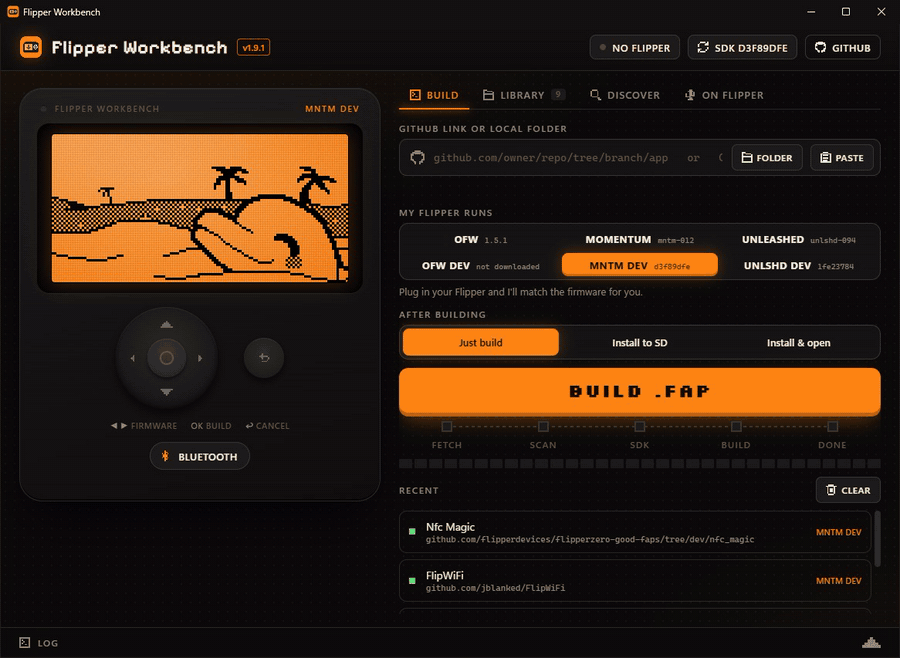

### Build from a link

1. Open the **Build** tab.
2. Paste a GitHub link. Workbench understands a repo, a branch, a subfolder
   (`https://github.com/user/repo/tree/dev/some_app`), a single file or a commit. You can also drag a link
   onto the window, or copy one before opening Workbench and it's pasted in for you.
3. Check the firmware. Workbench picks your Flipper's firmware automatically; change it with the firmware
   buttons (or the d-pad's left and right) if you're building for another Flipper.
4. Press **Build**. Progress shows on the dolphin's screen, in the stage list and in the log.
5. When it's done, choose **Install to SD** (copies the app into `apps/<Category>/` on the SD card) or
   **Install & open** (also starts it on the Flipper).

If a repo holds several apps, a checklist opens with each app's icon so you can pick the ones you want.
Links to a whole firmware or to huge collections (more than 25 apps) are refused: paste the link to the
app's own folder instead.

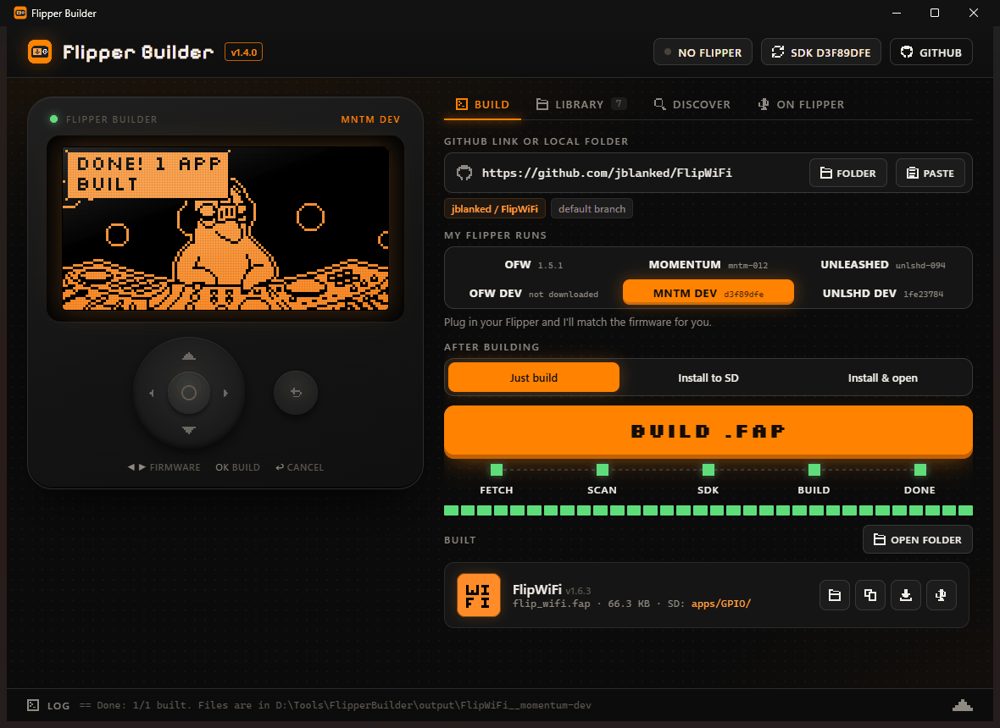

### When a build fails

Workbench explains the error in plain English: a function your firmware doesn't have, a missing library,
an app that hasn't been updated for current firmware. It also offers one-click buttons to try another
firmware, because many apps only build on Momentum or only on Official.

### Build from a folder on your PC

Press **Folder** next to the link box and pick a folder on your PC to build your own code. Then click the
**watch & rebuild** chip under the link box, and Workbench rebuilds (and reinstalls) every time you save a
file. Handy together with [New app](#new-app).

---

## 5. Library and Discover

### Library

Every app you build is remembered in the **Library**, per firmware. Badges show which apps run on the
plugged-in Flipper and which are out of date. After a firmware update, **Rebuild all** rebuilds every app
for the new firmware and installs them in one go.

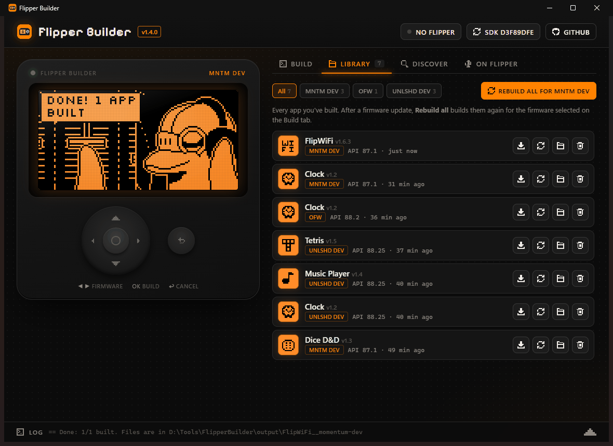

### Discover: Flipper's Apps Catalog

Search the 500+ apps in Flipper's official Apps Catalog by name or category, and build any of them in one
click. Workbench builds the exact version Flipper reviewed, not whatever happens to be newest on GitHub.

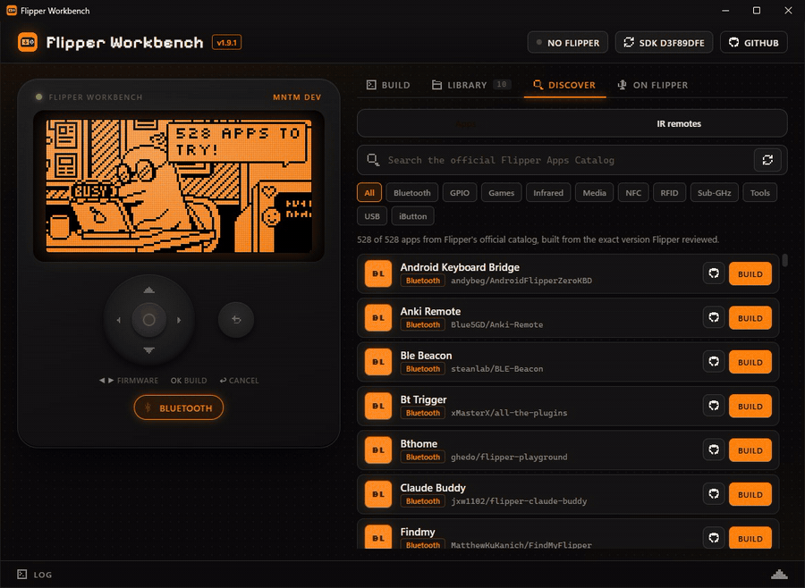

### Discover: IR remotes

The **IR remotes** section searches the roughly 8,900 remotes of the community
[Flipper-IRDB](https://github.com/Lucaslhm/Flipper-IRDB) by brand, model or device type. Open one to see
its buttons, try them from your Flipper (point it at the device), and install the remote to `infrared/` in
one click.

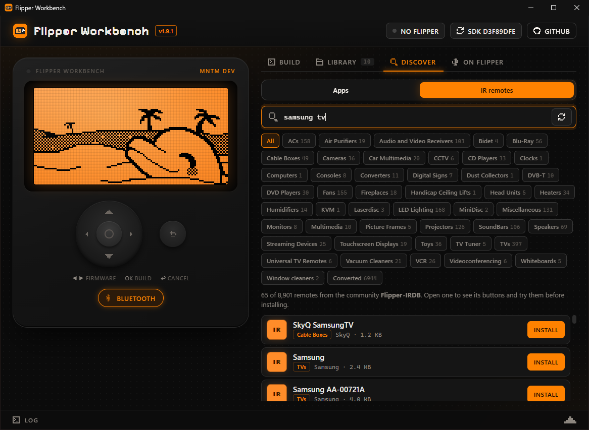

---

## 6. Your Flipper: the On Flipper tab

Plug in your Flipper and open **On Flipper**. The top shows its name, firmware, API version and port, a bar
of SD card space, and four buttons: **Firmware**, **SD map**, **Clean up** and **Refresh**. Below are six
sections: Apps, Files, Backups, CLI, Tools and Studio.

### Apps

Every app on the SD card, with its real name, version and icon, grouped by category. Apps that won't open on
your firmware are flagged. For each app you can **open** it on the Flipper, **remove** it, or **update** it
from your Library or straight from the catalog when a newer version exists. **Update all** updates every
outdated app in one go. Nothing is removed without asking.

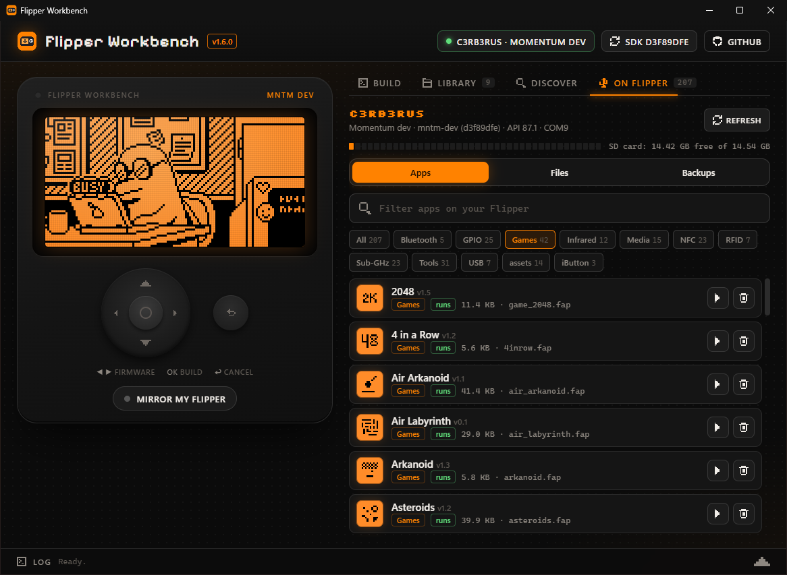

### Files

Browse the whole SD card: upload, download, rename, make folders and delete. Click a capture file to see
what's inside in plain language:

- **`.sub`** (Sub-GHz): frequency, modulation, protocol and a picture of the signal.
- **`.ir`** (infrared): every button, each with **Send** to fire it from the Flipper. **Edit buttons** lets
  you rename, reorder and remove them, or add all the buttons of another remote.
- **`.nfc`, `.rfid`, `.ibtn`**: card type, UID and data blocks. Two NFC dumps can be compared byte by byte.

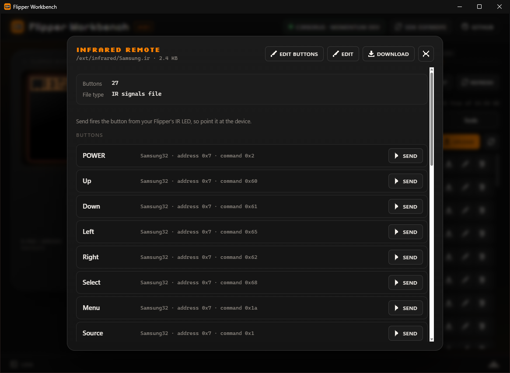

Text files, BadUSB scripts and JavaScript apps open in the **script editor**, with syntax highlighting and
Ctrl+S to save straight to the SD card. **Save & run** starts a JavaScript app and shows its output in the
CLI.

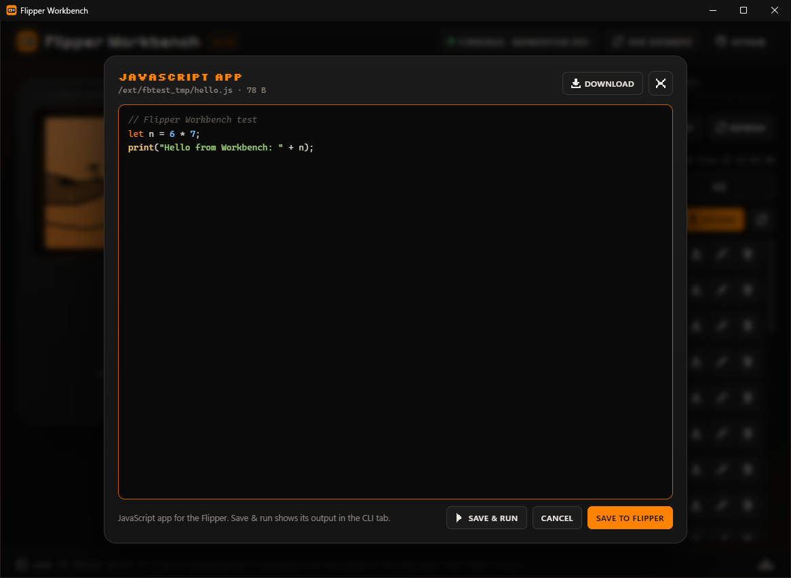

### Backups

One click backs up your captures, NFC/RFID dumps, IR remotes, BadUSB scripts and app data to a zip on your
PC, and **Restore** puts them back later (restoring never deletes anything on the Flipper). With **auto
backup** on, plugging in your Flipper backs it up once a day; the last 5 automatic backups are kept, and
backups you make yourself are never deleted.

### CLI

Your Flipper's own command line, in a terminal tab. Type any command (`help`, `neofetch`,
`storage info /ext`, `log`...) and the output streams back. Up and Down recall earlier commands; **Stop** or
Ctrl+C ends commands that keep running. Commands that delete things, change settings or transmit (like
`storage remove`, `ir tx`, `subghz tx`) ask before they run. **Follow log** shows the Flipper's log, filtered
to what you want.

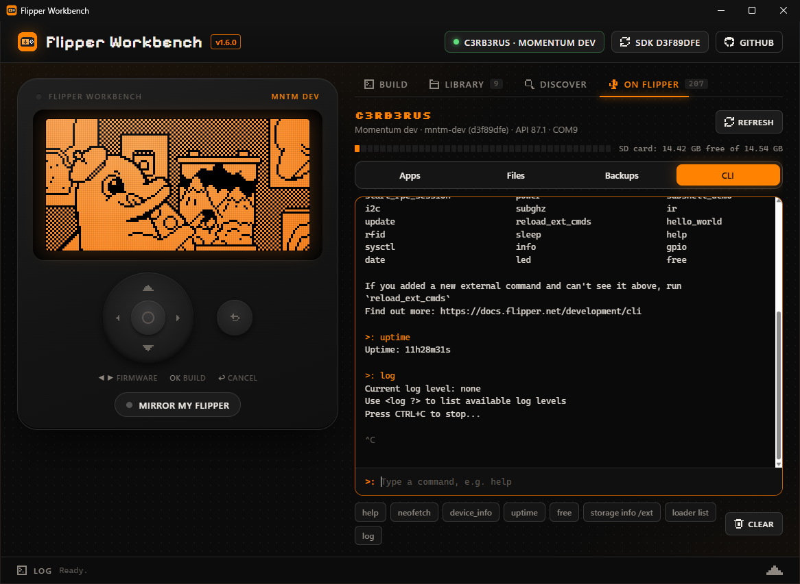

### Firmware

Update to the latest Official, Momentum or Unleashed firmware, as a release or dev build, in two steps:

1. **Prepare:** Workbench checks the battery (at least 50%) and free space, offers a backup, downloads the
   official update package, checks its SHA-256, copies it to the Flipper and checks every file there.
   Nothing is installed yet.
2. **Install:** only after you confirm again, the Flipper's own updater takes over, exactly as with
   qFlipper. Workbench waits for the Flipper to come back on the new version, then offers to rebuild your
   apps for it.

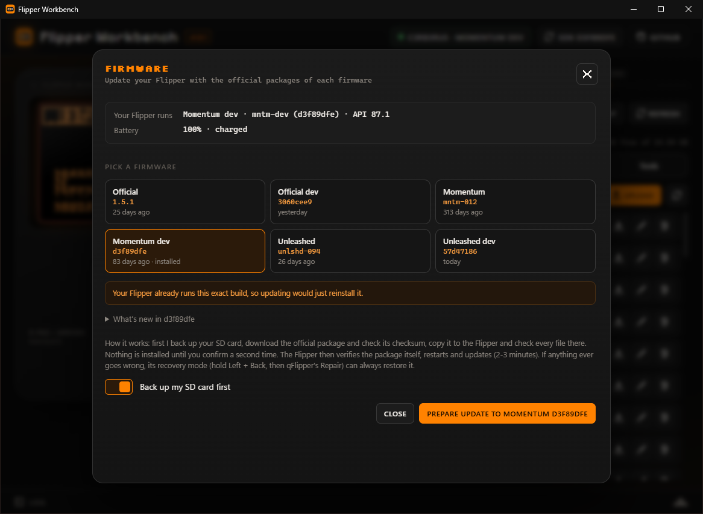

### SD map

A map of what fills your SD card, folder by folder. Bigger blocks use more space; click one to look inside
or open it in Files. Space by file type is shown alongside.

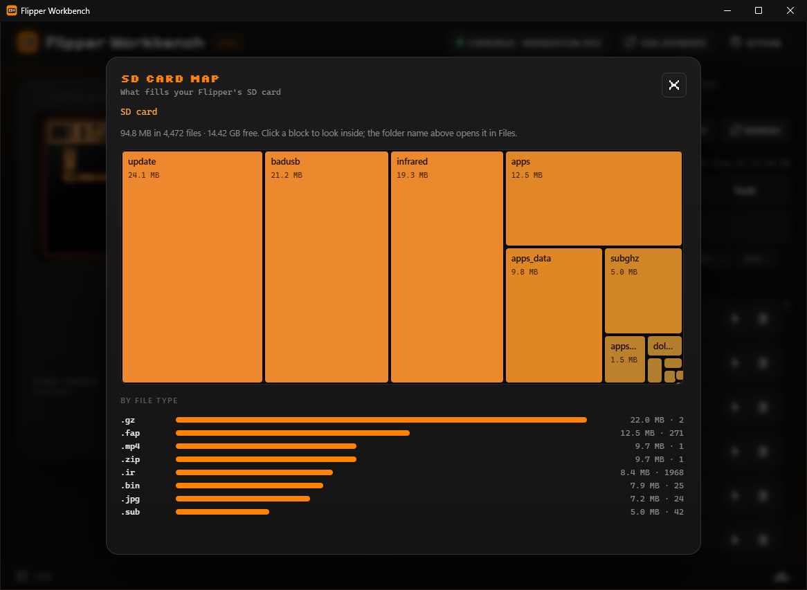

### Clean up

Finds the same app in two folders, apps that won't open on your firmware, old firmware update packages and
leftover temporary files. You tick what goes; nothing is deleted on its own.

---

## 7. Screen mirror and remote control

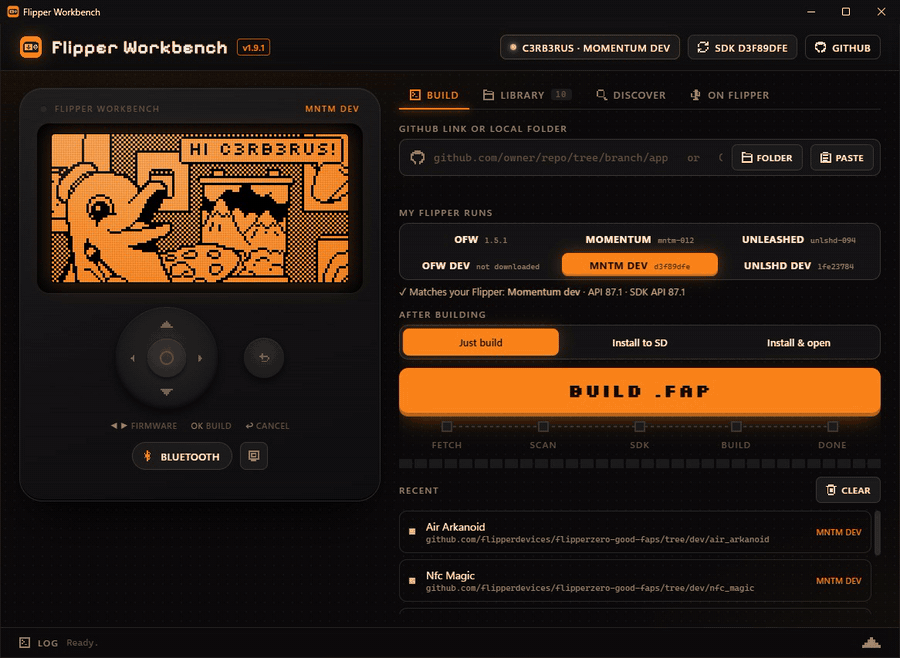

When your Flipper is plugged in, the screen on the left shows its real display, live.

- **Control it:** click the d-pad or use the keyboard (arrows, Enter = OK, Backspace = Back). Hold a button
  for a long press.
- **Full screen:** click the screen; Esc, F11 or another click goes back.
- **Screenshot:** one click saves a PNG of the Flipper's screen.
- **Record:** record up to 60 seconds as a GIF to share, or as an MP4 video (turn on *Save screen recordings
  as MP4 videos* in Tools).
- **Frame:** screenshots and recordings can come inside a drawn Flipper.
- **Pause:** the small screen button pauses the mirror. *Show my Flipper's screen as soon as it's plugged
  in* (in Tools) controls whether it starts on its own.
- **Several Flippers:** click the Flipper pill in the header to choose which one you're looking at.
- **Bluetooth** (experimental): the **Bluetooth** button under the screen mirrors and controls the Flipper
  without a cable. The first time, type the PIN your Flipper shows; after that it reconnects in a couple of
  seconds.

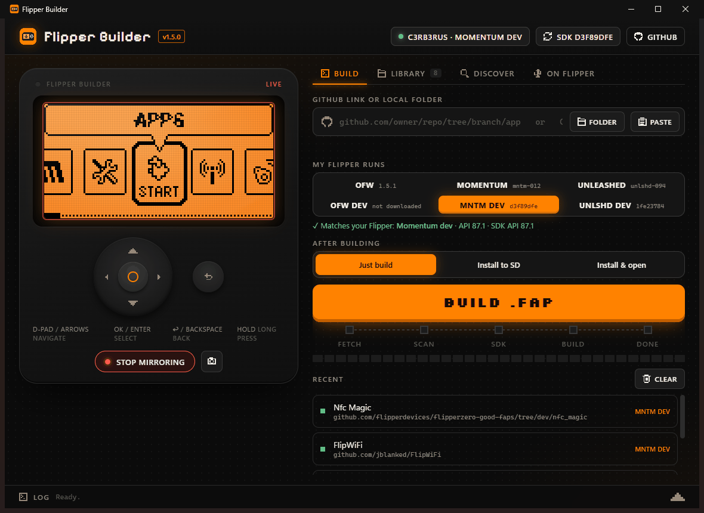

---

## 8. Tools

**On Flipper > Tools** holds the smaller tools, each in its own fold-out panel. Click a title to open it.

### Health check

Is your Flipper running low on memory? Health check shows, live:

- **Free memory**, with a graph of the last few minutes and the biggest free block.
- **Lowest since restart:** how close the Flipper came to running out. Red means it got close; that's what
  "out of memory" crashes are.
- **Battery** charge, state, health and temperature, and **SD card** space.

It updates every 5 seconds while the panel is open (each check pauses the mirror for about a second); untick
*Update every 5 seconds* to stop it.

**Check my packs** looks at every asset pack and the dolphin folder and shows how much memory each needs
while it's selected: its icons and fonts all the time, plus the animation that's playing. The heaviest
animations are listed. If a pack has old, uncompressed frames that would get smaller, a **Shrink** button
says how much it saves and compresses them in place; the pictures stay exactly the same. The pack your
Flipper is using is never changed: pick another one in Momentum's settings first.

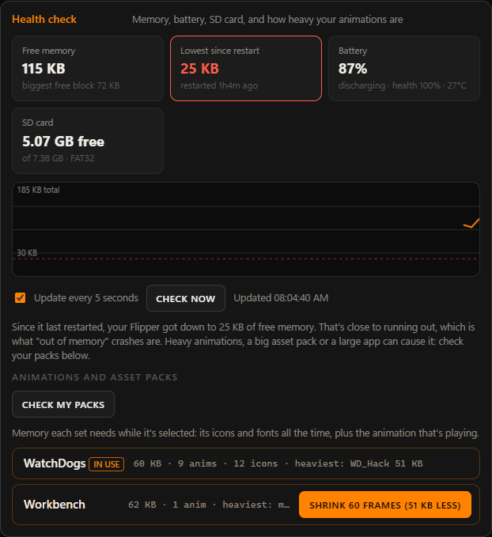

### IR remote builder

Make one remote with exactly the buttons you want, from any mix of sources:

1. Give the remote a name, like *Living Room*.
2. Add buttons from the **IR database** (search a brand or model), **On my Flipper** (remotes already on
   the SD card), **Learn from a remote** (point a real remote at the Flipper and press its buttons), or
   **Type in** (protocol, address and command, or raw timings).
3. Rename, reorder (◀ ▶), duplicate or remove buttons. **Test** sends a button from the Flipper so you can
   check it works.
4. **Save to Flipper** puts it in the Infrared app under Saved Remotes, or **Save to PC** keeps a copy.

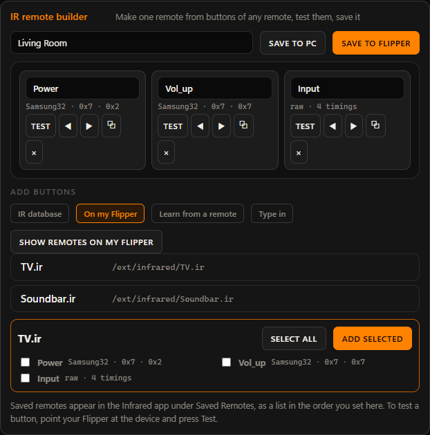

### BadUSB scripts

Write and edit the scripts the Flipper's BadUSB app types into a computer. **Show my scripts** lists the
scripts on your Flipper, subfolders included. As you type, commands are highlighted and checked against
what the BadUSB app understands: mistakes are underlined and listed with the line number. **Keyboard
layout** sets the layout the BadUSB app uses (open the BadUSB app on your Flipper once first, it creates its
settings then).

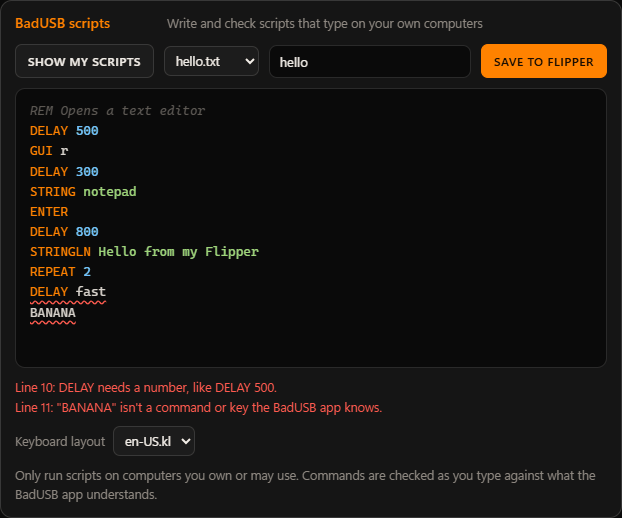

### Passport

*(Momentum)* Change your Flipper's name (up to 8 letters and numbers) and see a preview of its passport
screen. **Use the real name** goes back to the Flipper's own name. The Flipper shows the new name after it
restarts, and Workbench offers to restart it for you. **Change the picture** takes you to Pack maker's
passport art.

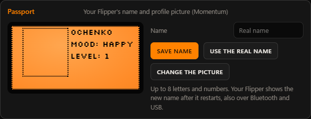

### Profiles

Save your Flipper's whole setup and switch between setups, like *Daily* and *Demo*. A profile keeps your
Momentum settings (asset pack, menu style and the rest), the Flipper's name and your app list. Tick
*Include my apps* to also keep the apps themselves. **Apply** puts a profile back: missing apps are copied,
and apps are only removed if you tick that box. The Flipper needs a restart to show the change.

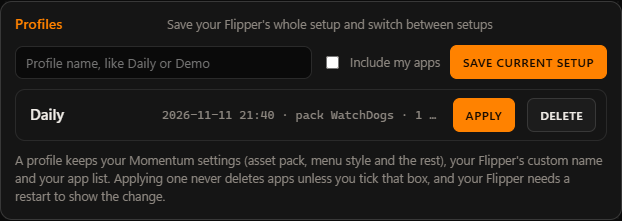

### New app

Start your own Flipper app from a template: pick one, give it a name and category, choose a folder, and
press **Create**. Workbench builds it, installs it and rebuilds on every save, so you can edit the code and
see the result on your Flipper straight away. *CLI > Follow log* shows just your app's log lines while you
test.

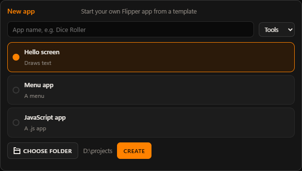

### Music

Turn a MIDI file or an RTTTL ringtone into a song for the Flipper's Music Player. Pick a file or paste a
ringtone, press **Convert**, then **Play** to hear it in Workbench first (it sounds like the Flipper's
buzzer). **Save to Flipper** puts it in the Music Player's folder.

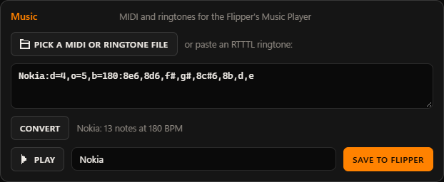

### NFC maker

Make an NFC tag your Flipper can emulate, from scratch. Pick what a phone should do when it touches the back
of your Flipper: open a **link**, show some **text**, join **Wi-Fi**, save a **contact**, **call** or
**text** a number, write an **email**, show a **location**, open an **Android app** or **pair Bluetooth**.
Fill in the blanks and Workbench writes a ready NTAG213, 215 or 216 file. Several records fit on one tag; the
bar shows how full it is.

**Save & emulate** saves it and starts emulating right away; **Save to Flipper** or **Save to PC** just keep
it. iPhones open links and contacts; Wi-Fi tags join networks on Android.

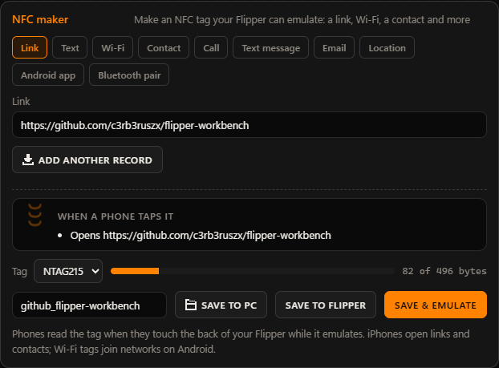

### Folder sync

Pair a folder on your PC with a folder on the SD card (say, your BadUSB scripts kept in a Git repo) and keep
them in step, one way or both ways. **Compare** shows every change before anything happens. Files are
compared by size and checksum, conflicts are yours to settle, and deleting extra files is opt-in: PC files
go to a `.workbench-trash` folder, never straight away.

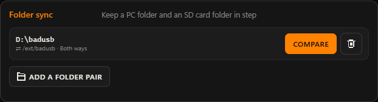

### More tools

- **MIFARE keys:** manage your own MIFARE Classic keys, which the Flipper tries on top of its built-in list
  when reading a card.
- **Wi-Fi dev board:** flash the official Black Magic debugger firmware onto the ESP32-S2 Wi-Fi dev board,
  or a compatible firmware file of your own (`.bin`, `.zip` or `.tgz`). Every part is checked to be an
  ESP32-S2 image before anything is written.
- **Phone remote:** your Flipper's screen and buttons on your phone over your home Wi-Fi. Turn it on, scan
  the code with your phone, no app needed. It only works on your home network, needs the link's secret
  code, and stops when you turn it off or close Workbench.
- **Companion app:** installs a small *Workbench* app to the Flipper's Apps > Tools that shows when
  Workbench last connected, backed up and synced.

---

## 9. Studio: animations and asset packs

**On Flipper > Studio** is where you change how your Flipper looks, next to its live screen.

### Animation maker

Turn a video, GIF or picture into a desktop animation for the Flipper's 128x64 black-and-white screen.

1. **Pick a video, GIF or image** (MP4, WebM, MOV, MKV, AVI, GIF, PNG, JPG), or drop one on the panel.
2. **Shape it:** trim with *Start* and *End*, then set the frame rate (up to 30 fps), the number of frames,
   threshold, contrast, dither, fit (fill, fit or stretch), zoom and framing, invert and background. The
   preview updates as you go, and the line above it says how much Flipper memory the animation needs.
3. **Edit frames:** draw with the pen, eraser, line, box, circle and text tools (tick *All frames* to draw
   on every frame at once); duplicate, move or remove frames; undo any time.
4. **Speech bubbles:** add a bubble like the dolphin's own, with its text, the frames it shows on, its
   position and which way its tail points.
5. **Mood and level:** choose when it plays (any mood, happy, okay or angry, and a level range) and how
   often.
6. **Show on my Flipper** plays it live on your real Flipper before you install anything. **Install to
   Flipper** adds it to your animations (on Momentum in an asset pack, otherwise in the dolphin folder).

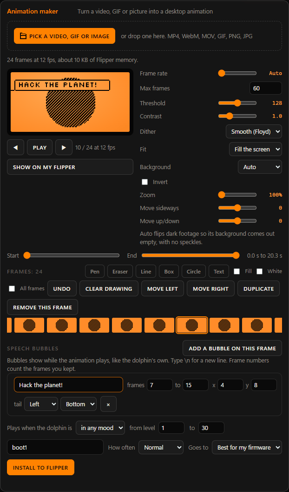

### Pack maker

*(Momentum)* Build your own asset pack: a set of desktop animations, passport art, icons and fonts that
replaces the Flipper's own look.

- **Create pack** starts an empty one; **Import a zip** or **Import a folder** brings in an existing pack
  (ready-made packs, PNG source packs and dolphin folders all work). Every file is checked, and anything
  broken is left out.
- Add **animations** (from GIFs, pictures or Animation maker), **passport art**, any of the Flipper's
  **icons** (search by name, like `MainMenu/NFC_14`) and **fonts**.
- **How it looks** previews the passport and main menu with your icons.
- The **memory bar** shows how heavy the pack is. Light packs are safe; heavy ones can leave big apps short
  of memory.
- **Install to Flipper** in one click, or **Save as zip** to share it.

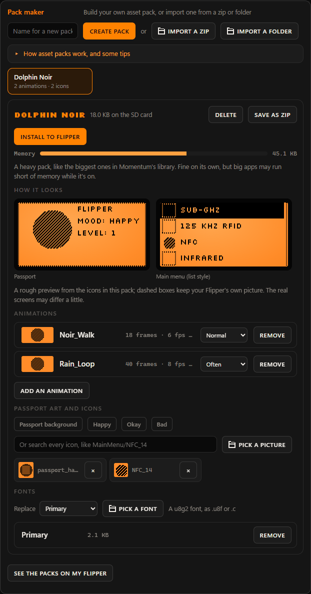

### Asset packs

Browse the packs in Momentum's online pack library and install any of them in one click; every download is
checked against its checksum.

---

## 10. Updates, settings and where your files live

**Updates:** Workbench checks for new versions on its own. When one is out, the **Update** button in the
header downloads it, checks it against the SHA-256 GitHub publishes, and restarts into it. Your build kits,
built apps, Library, settings and backups stay. If the swap fails, the old version is put back.

**Where your files live:** everything is kept in the folder you unzipped Workbench into, next to
`FlipperWorkbench.exe`:

| Folder or file | What's in it |
|---|---|
| `output\` | The apps you built (`.fap` files), per repo and firmware |
| `backups\` | Your Flipper backups (zip files) |
| `profiles\` | Saved profiles |
| `my_packs\` | Asset packs you made or imported in Pack maker |
| `.cache\` | Build kits (SDKs), the toolchain and cached catalog data. Safe to delete; it's downloaded again |
| `settings.json`, `library.json` | Your settings and the Library |

To move Workbench, move the whole folder.

---

## 11. Troubleshooting

**Workbench doesn't see my Flipper.**
Close qFlipper and any browser tab using the Flipper (only one program can use its USB port), try another
cable (charge-only cables don't carry data), and make sure the Flipper is switched on and not in update or
recovery mode.

**The app says "API mismatch" on the Flipper.**
It was built for a different firmware. Rebuild it in Workbench with your Flipper plugged in, or use
**Rebuild all** in the Library after a firmware update.

**A build failed.**
Read the plain-English reason above the log, and try the **other firmware** buttons: many community apps
only build on one firmware. Some apps are simply out of date with current firmware.

**My Flipper says it's out of memory, or restarts.**
Open **Tools > Health check**. If *Lowest since restart* is red, check your packs: a heavy asset pack or
animation is the usual cause. Pick a lighter pack, shrink one, or remove the heaviest animation. Closing the
screen mirror while a big app runs also frees a little memory.

**The first build takes long.**
The first build for a firmware downloads Flipper's toolchain and that firmware's SDK. Later builds are much
faster. Build kits refresh themselves once a day; the **SDK** button in the header forces it.

---

## 12. Using it responsibly

The Flipper can send infrared, Sub-GHz and NFC signals and type into computers. Workbench makes those things
easier, so a few reminders:

- **BadUSB:** only run scripts on computers you own or have permission to use.
- **Transmitting:** IR, Sub-GHz and NFC transmissions are regulated differently from country to country.
  Only control your own devices.
- **Safety nets:** commands that transmit, delete or change settings ask before they run, firmware is never
  installed without a second confirmation, nothing on the Flipper is deleted on its own, and backups never
  remove files.

---

*Flipper Workbench is an independent project, not made or endorsed by Flipper Devices. Questions, ideas or
bugs: open an [issue](https://github.com/c3rb3ruszx/flipper-workbench/issues).*
